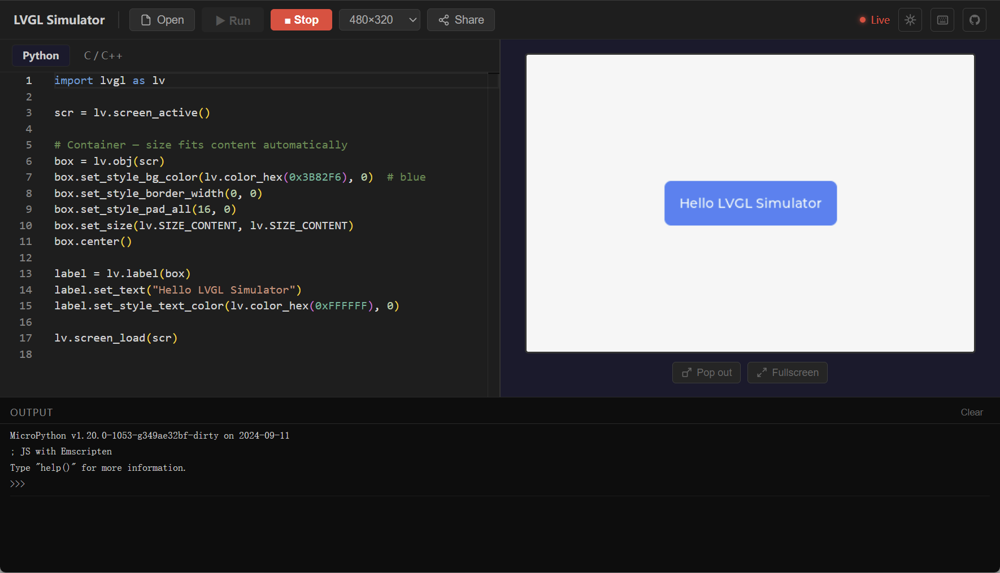
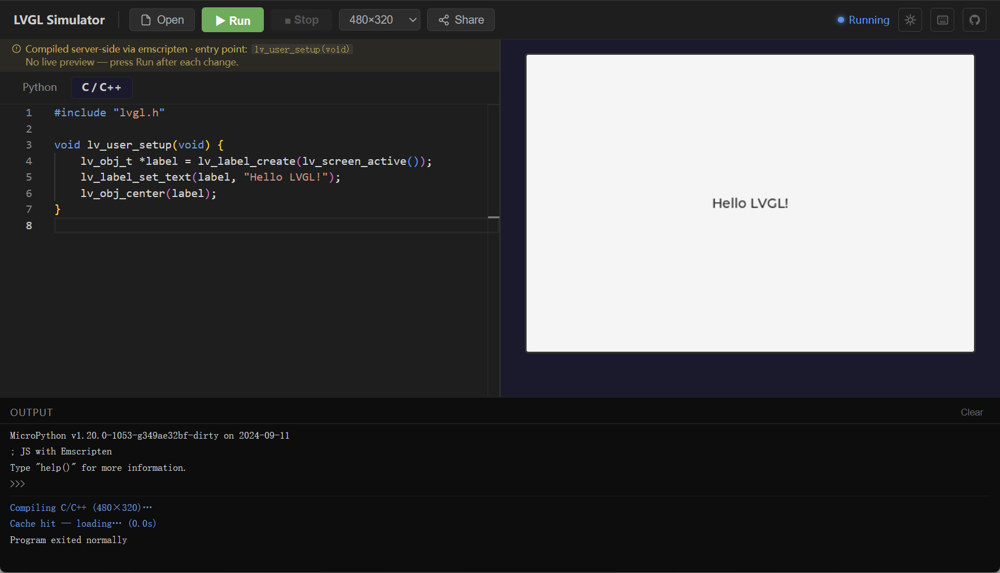

# lvgl-simulator-docker

## 1 Build image

### 1.1 lvgl-compile-server

```bash
# git
git clone https://github.com/deeeemiss/lvgl-simulator.git

# env
cp .env.example .env

# build
cd lvgl-simulator/server
docker-compose up --build
docker tag server-compile-server:latest ik8share/lvgl-compile-server:v261125b1
docker tag server-compile-server:latest ik8share/lvgl-compile-server:latest
```

### 1.2 lvgl-simulator

```bash
# download https://www.jsdelivr.com/package/npm/monaco-editor
tar -xvf monaco-editor-0.55.1.tgz
mv package/min/vs lvgl-simulator/public

# optimize
sed -i '3i\
import { loader } from '@monaco-editor/react';\
loader.config({ paths: { vs: '/vs' } });' src\components\Editor.tsx

# build
npm install
npm run build
docker build -t ik8share/lvgl-simulator:v261125b1 .
docker tag ik8share/lvgl-simulator:v261125b1 ik8share/lvgl-simulator:latest
```

## 2 Docker deploy

### 2.1 compose.yaml - [Docker Hub](hub.docker.com)

```yaml
services:
  lvgl-compile-server:
    image: ik8share/lvgl-compile-server:latest
    container_name: lvgl-compile-server-single
    restart: unless-stopped
    environment:
      - TZ=Asia/Shanghai
    ports:
      - "3001"
  lvgl-simulator:
    image: ik8share/lvgl-simulator:latest
    container_name: lvgl-simulator-single
    restart: unless-stopp
    environment:
      - TZ=Asia/Shanghai
    ports:
      - "5173:5173"
```

### 2.2 compose.yaml - [Aliyun ACR](registry.cn-hangzhou.aliyuncs.com)

```yaml
services:
  lvgl-compile-server:
    image: crpi-jxv5pjfspukj6x6s.cn-hangzhou.personal.cr.aliyuncs.com/aaric/lvgl-compile-server:latest
    container_name: lvgl-compile-server-single
    restart: unless-stopped
    environment:
      - TZ=Asia/Shanghai
    ports:
      - "3001"
  lvgl-simulator:
    image: crpi-jxv5pjfspukj6x6s.cn-hangzhou.personal.cr.aliyuncs.com/aaric/lvgl-simulator:latest
    container_name: lvgl-simulator-single
    restart: unless-stopp
    environment:
      - TZ=Asia/Shanghai
    ports:
      - "5173:5173"
```

### 2.2 Startup

```bash
docker compose up -d
docker compose ps
```

## 3 Preview

### 3.1 `Python`



### 3.2 `C / C++`


